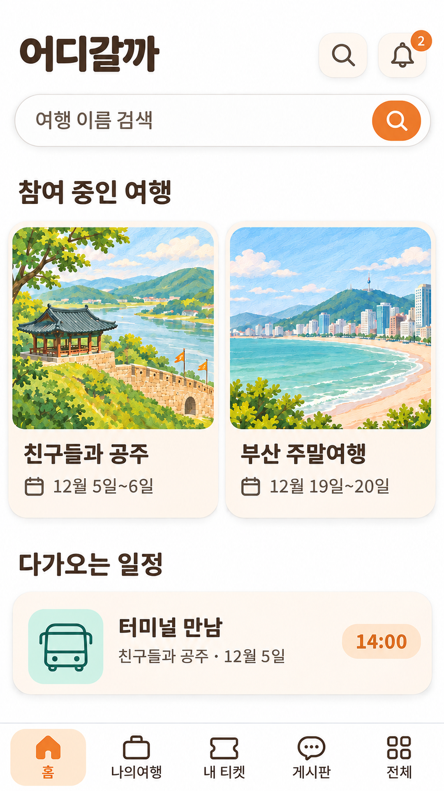
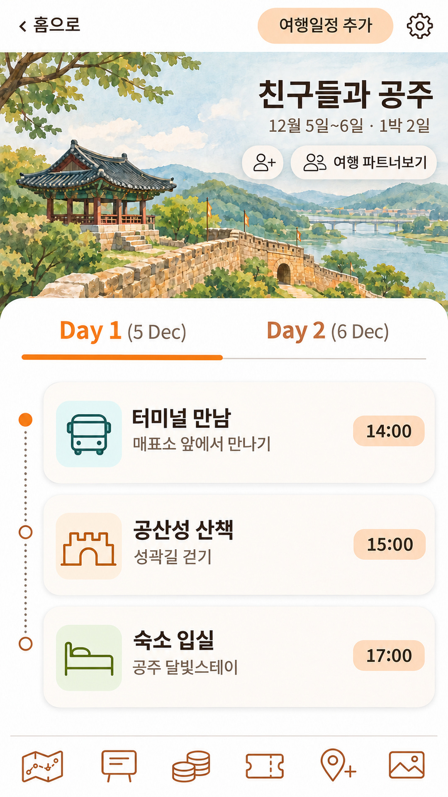
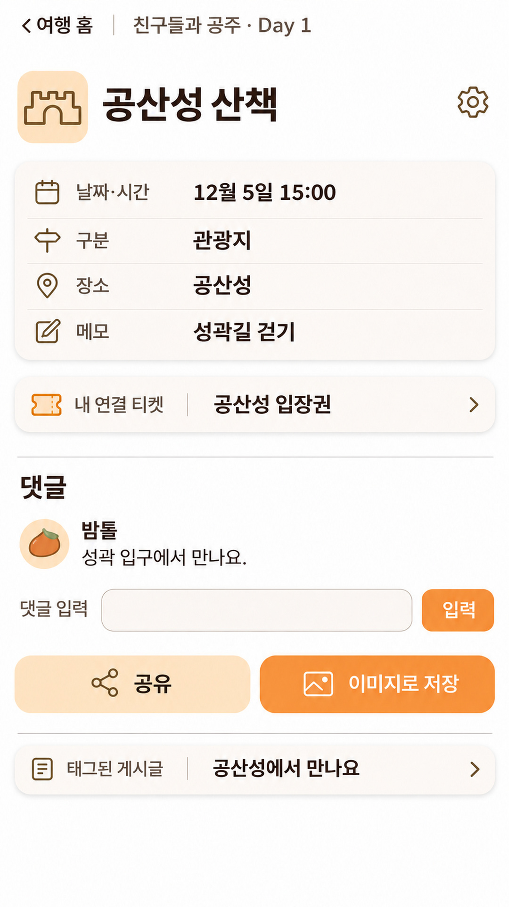
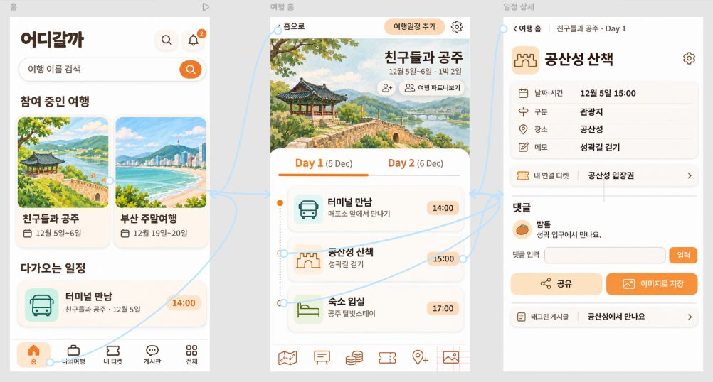

# 어디갈까 · 함께 짜는 여행 플래너

초대코드로 여행에 참여한 친구들이 공주에 가는 날, 몇 시에 어디서 만나기로 했는지 찾아보는 모바일 여행 플래너입니다. 홈에서 여행을 고르면 첫날의 약속이 시간순으로 보이고, 일정을 누르면 장소와 동행자의 메모를 읽을 수 있습니다.

[**Figma 프로젝트 보기**](https://www.figma.com/design/L79jkVEj1gDi1gKLEOAZqL/%EC%96%B4%EB%94%94%EA%B0%88%EA%B9%8C-%C2%B7-%EA%B3%B5%EC%A3%BC-%EC%97%AC%ED%96%89-%ED%94%84%EB%A1%9C%ED%86%A0%ED%83%80%EC%9E%85-%EC%B4%88%EC%95%88?node-id=0-1) · [클릭 시연 시작](https://www.figma.com/proto/L79jkVEj1gDi1gKLEOAZqL/%EC%96%B4%EB%94%94%EA%B0%88%EA%B9%8C-%C2%B7-%EA%B3%B5%EC%A3%BC-%EC%97%AC%ED%96%89-%ED%94%84%EB%A1%9C%ED%86%A0%ED%83%80%EC%9E%85-%EC%B4%88%EC%95%88?node-id=1-43&scaling=min-zoom&content-scaling=fixed&page-id=0%3A1) · [화면 흐름과 클릭 영역](figma/화면흐름_Hotspot.png) · [작업 로그](작업로그.md)

| 항목 | 내용 |
|---|---|
| 프로젝트명 | **어디갈까** |
| 서비스 한 줄 소개 | 함께 짜는 여행 플래너 |
| 과제 | 본과정 미션 4-1 · 세미나 A (AI 기반 UI/UX 디자인 시안 제작) |
| Figma 프로젝트 링크 | [디자인 파일](https://www.figma.com/design/L79jkVEj1gDi1gKLEOAZqL/%EC%96%B4%EB%94%94%EA%B0%88%EA%B9%8C-%C2%B7-%EA%B3%B5%EC%A3%BC-%EC%97%AC%ED%96%89-%ED%94%84%EB%A1%9C%ED%86%A0%ED%83%80%EC%9E%85-%EC%B4%88%EC%95%88?node-id=0-1) · [홈에서 시연 시작](https://www.figma.com/proto/L79jkVEj1gDi1gKLEOAZqL/%EC%96%B4%EB%94%94%EA%B0%88%EA%B9%8C-%C2%B7-%EA%B3%B5%EC%A3%BC-%EC%97%AC%ED%96%89-%ED%94%84%EB%A1%9C%ED%86%A0%ED%83%80%EC%9E%85-%EC%B4%88%EC%95%88?node-id=1-43&scaling=min-zoom&content-scaling=fixed&page-id=0%3A1) |
| 화면 흐름·Hotspot 캡처 | [세 화면과 연결선 원본 PNG](figma/화면흐름_Hotspot.png) |

## 최종 UI 시안

| 홈 · 여행 고르기 | 여행 홈 · 첫날 일정 보기 | 일정 상세 · 약속 확인하기 |
|:---:|:---:|:---:|
|  |  |  |
| ‘친구들과 공주’를 선택합니다. | 15:00 ‘공산성 산책’을 누릅니다. | ‘성곽길 걷기’ 메모와 만날 곳을 확인합니다. |

세 이미지는 각각 **1080 × 1920px, 세로 9:16 PNG**입니다. 시안을 누르면 원래 크기로 열립니다. 여행명·날짜·닉네임은 시연용 예시입니다.

## 프로토타입에서 따라가기

| 출발 화면 | 누를 곳 | 도착 화면 |
|---|---|---|
| 홈 | ‘친구들과 공주’ 여행 카드 | 여행 홈 · Day 1 |
| 여행 홈 | 15:00 ‘공산성 산책’ 카드 | 일정 상세 · 공산성 산책 |
| 일정 상세 | 왼쪽 위 ‘‹ 여행 홈’ | 여행 홈 · Day 1 |
| 여행 홈 | 왼쪽 위 ‘‹ 홈으로’ | 홈 |

Figma에서 위 네 동작을 직접 재생했습니다. 파일의 공유 설정은 ‘누구나 볼 수 있음’입니다.

## 사용 도구

| 용도 | 도구 이름 | 사용한 작업 |
|---|---|---|
| 이미지 생성·수정 | ChatGPT 이미지 생성 | 공주·부산 풍경을 담은 세로 시안 3장을 만들고, 배경과 일정 아이콘을 단계별로 수정했습니다. |
| 이미지 후가공 | ImageMagick | 생성본을 1080 × 1920px로 내보내고, 일정 상세의 하단 여백을 정리했습니다. |
| 프로토타입 | Figma Design | 화면을 배치하고 여행 카드·일정 카드·뒤로 가기에 클릭 영역을 연결했습니다. |

## 참고 자료

| 자료명 | 출처와 적용한 화면 |
|---|---|
| 여행 플래너 기획서와 엽서풍 디자인 명세 | 프로젝트에서 작성한 기획서와 작성자가 제공한 두 화면 참고 이미지를 토대로 화면 역할·분위기를 정리했습니다. [홈 초안에 적용한 내용](작업로그.md#home-draft) |
| 공주 성곽·부산 바다와 일정 아이콘 | 이 프로젝트의 ChatGPT 생성 시안을 다음 수정의 참조 이미지로 사용했습니다. 홈의 풍경은 여행지를, 여행 홈의 버스·성곽·침대 아이콘은 일정 종류를 나타냅니다. [여행 홈 수정 기록](작업로그.md#timeline) |

## 최종 결과물

| 산출물 | 제출 자료 |
|---|---|
| 1. UI 디자인 이미지 3장 | [메인 · 홈](ui/화면1_메인.png) · [목록 · 여행 홈](ui/화면2_목록.png) · [상세 · 공산성 산책](ui/화면3_상세.png) |
| 2. 작업 로그 1개 | 초안 → 수정 → 최종의 실제 입력 프롬프트, 변경 이유와 결과 차이. [작업로그.md](작업로그.md) |
| 3. Figma 프로젝트 1개 | [디자인 파일](https://www.figma.com/design/L79jkVEj1gDi1gKLEOAZqL/%EC%96%B4%EB%94%94%EA%B0%88%EA%B9%8C-%C2%B7-%EA%B3%B5%EC%A3%BC-%EC%97%AC%ED%96%89-%ED%94%84%EB%A1%9C%ED%86%A0%ED%83%80%EC%9E%85-%EC%B4%88%EC%95%88?node-id=0-1) · [클릭 시연](https://www.figma.com/proto/L79jkVEj1gDi1gKLEOAZqL/%EC%96%B4%EB%94%94%EA%B0%88%EA%B9%8C-%C2%B7-%EA%B3%B5%EC%A3%BC-%EC%97%AC%ED%96%89-%ED%94%84%EB%A1%9C%ED%86%A0%ED%83%80%EC%9E%85-%EC%B4%88%EC%95%88?node-id=1-43&scaling=min-zoom&content-scaling=fixed&page-id=0%3A1) · [Hotspot 캡처](figma/화면흐름_Hotspot.png) |
| 4. 코랩 세션 리포트 1개 | 조별 세션에서 각자 만든 화면과 제작 방법을 비교한 뒤 `코랩세션리포트.md`로 추가합니다. |
