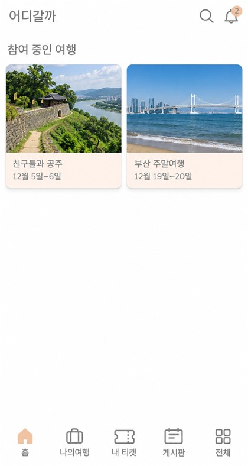
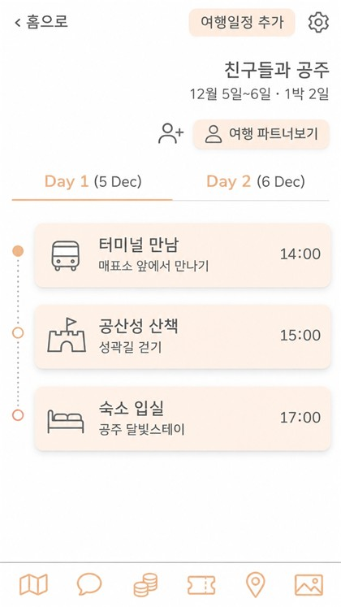
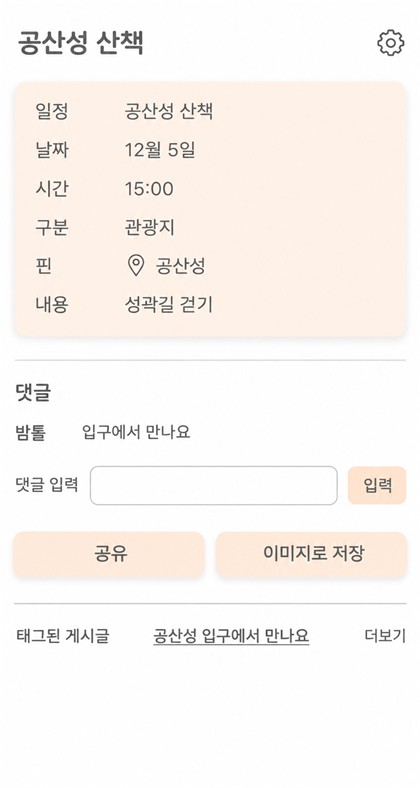
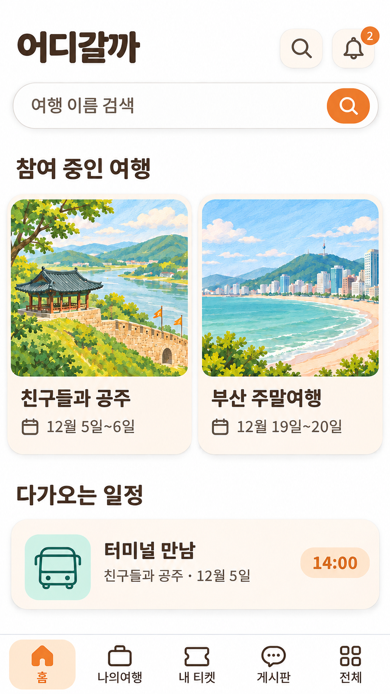
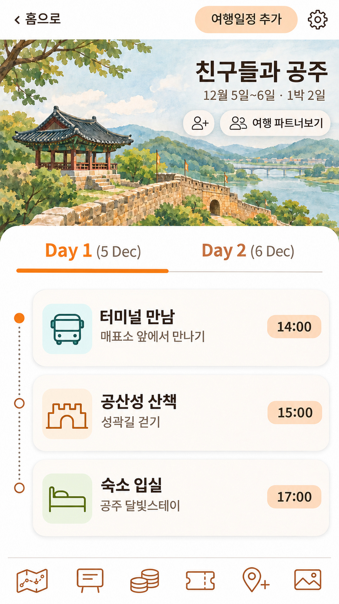
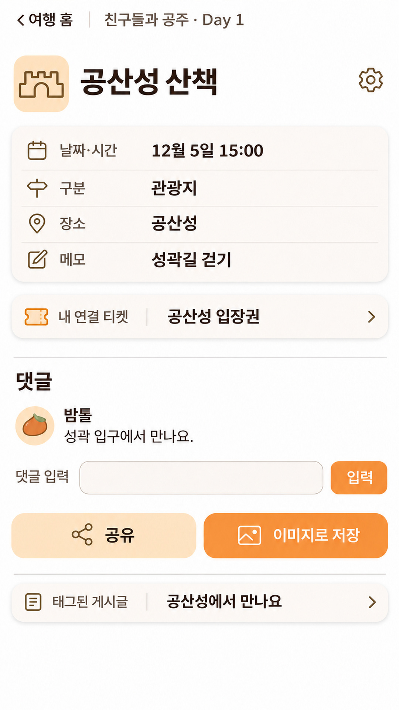

# 어디갈까 · UI 디자인 작업 로그

[제출 화면과 프로토타입](README.md) · [수정에 사용한 디자인 명세](#design-input) · [홈](#home) · [여행 홈](#timeline) · [일정 상세](#detail)

## 생성 이미지 한눈에 보기

| 제작 단계 | 홈 · 여행 선택 | 여행 홈 · Day 1 | 일정 상세 · 공산성 산책 |
| :--- | :---: | :---: | :---: |
| **초안** | <a href="figma/초안/홈.jpg"></a><br>v03 | <a href="figma/초안/여행홈.jpg"></a><br>v02 | <a href="figma/초안/일정상세.jpg"></a><br>v02 |
| **수정 1**<br>엽서풍 디자인 적용 | <a href="https://github.com/blue592/travel-planner-dev/blob/40780937ac41cc8e7c74e13dd26f92f1b43533bb/docs/drafts/m04-1-06-%ED%99%88-%EC%8B%9C%EC%95%88.v04.png"></a><br>[홈 v04](https://github.com/blue592/travel-planner-dev/blob/40780937ac41cc8e7c74e13dd26f92f1b43533bb/docs/drafts/m04-1-06-%ED%99%88-%EC%8B%9C%EC%95%88.v04.png) | <a href="https://github.com/blue592/travel-planner-dev/blob/40780937ac41cc8e7c74e13dd26f92f1b43533bb/docs/drafts/m04-1-12-%EC%97%AC%ED%96%89%ED%99%88-%EC%8B%9C%EC%95%88.v03.png"></a><br>[여행홈 v03](https://github.com/blue592/travel-planner-dev/blob/40780937ac41cc8e7c74e13dd26f92f1b43533bb/docs/drafts/m04-1-12-%EC%97%AC%ED%96%89%ED%99%88-%EC%8B%9C%EC%95%88.v03.png) | <a href="https://github.com/blue592/travel-planner-dev/blob/40780937ac41cc8e7c74e13dd26f92f1b43533bb/docs/drafts/m04-1-19-%EC%9D%BC%EC%A0%95%EC%83%81%EC%84%B8-%EC%8B%9C%EC%95%88.v03.png"></a><br>[일정상세 v03](https://github.com/blue592/travel-planner-dev/blob/40780937ac41cc8e7c74e13dd26f92f1b43533bb/docs/drafts/m04-1-19-%EC%9D%BC%EC%A0%95%EC%83%81%EC%84%B8-%EC%8B%9C%EC%95%88.v03.png) |
| **수정 2**<br>흰 배경 적용 | <a href="https://github.com/blue592/travel-planner-dev/blob/40780937ac41cc8e7c74e13dd26f92f1b43533bb/docs/drafts/m04-1-06-%ED%99%88-%EC%8B%9C%EC%95%88.v05.png"></a><br>[홈 v05](https://github.com/blue592/travel-planner-dev/blob/40780937ac41cc8e7c74e13dd26f92f1b43533bb/docs/drafts/m04-1-06-%ED%99%88-%EC%8B%9C%EC%95%88.v05.png) | <a href="https://github.com/blue592/travel-planner-dev/blob/40780937ac41cc8e7c74e13dd26f92f1b43533bb/docs/drafts/m04-1-12-%EC%97%AC%ED%96%89%ED%99%88-%EC%8B%9C%EC%95%88.v04.png"></a><br>[여행홈 v04](https://github.com/blue592/travel-planner-dev/blob/40780937ac41cc8e7c74e13dd26f92f1b43533bb/docs/drafts/m04-1-12-%EC%97%AC%ED%96%89%ED%99%88-%EC%8B%9C%EC%95%88.v04.png) | <a href="https://github.com/blue592/travel-planner-dev/blob/40780937ac41cc8e7c74e13dd26f92f1b43533bb/docs/drafts/m04-1-19-%EC%9D%BC%EC%A0%95%EC%83%81%EC%84%B8-%EC%8B%9C%EC%95%88.v04.png"></a><br>[일정상세 v04](https://github.com/blue592/travel-planner-dev/blob/40780937ac41cc8e7c74e13dd26f92f1b43533bb/docs/drafts/m04-1-19-%EC%9D%BC%EC%A0%95%EC%83%81%EC%84%B8-%EC%8B%9C%EC%95%88.v04.png) |
| **최종**<br>일정 종류별 아이콘 | <a href="ui/화면1_메인.png"></a><br>v06 | <a href="ui/화면2_목록.png"></a><br>v05 | <a href="ui/화면3_상세.png"></a><br>v05 |

초안은 제작 과정을 보여 주는 자료다. 제출용 [최종 Figma 디자인](https://www.figma.com/design/HK50rd640kTB1iIvAElPIe/?node-id=0-1)에는 마지막 행의 디자인을 넣었다.

## 최종 산출물 구성

| 항목 | 내용 |
|---|---|
| 프로젝트명 | **어디갈까** |
| 한 줄 소개 | 함께 짜는 여행 플래너 |
| 화면 1 · 홈 (메인) | 여행 이름 검색창과 ‘참여 중인 여행’ 카드로 공주·부산 여행을 구분하고, 다가오는 일정을 확인한다. [홈 PNG](ui/화면1_메인.png) |
| 화면 2 · 여행 홈 (목록) | ‘친구들과 공주’의 Day 1 타임라인에서 터미널 만남, 공산성 산책, 숙소 입실을 시간순으로 보고 일정을 선택한다. [여행 홈 PNG](ui/화면2_목록.png) |
| 화면 3 · 일정 상세 | ‘공산성 산책’의 날짜·시간·장소와 메모, 연결된 입장권, 동행자의 댓글을 확인한다. [일정 상세 PNG](ui/화면3_상세.png) |

초안의 화면별 버전은 홈 v03, 여행 홈 v02, 일정 상세 v02다. 각 화면의 ‘사용자가 직접 입력한 질문 원문’에는 당시 채팅에 보낸 메시지 전문을 실었다. 같은 요청을 세 화면에 함께 보낸 단계에는 그 메시지를 각 화면에 표시했다. 초안 미리보기는 초안 JPEG를 축소했다. 각 표에는 생성 원본 PNG 파일명을 적었다. 생성 완료 시각은 모두 한국 표준시다.

<a id="design-input"></a>

## 수정에 사용한 디자인 명세

2026-11-27 19:52에 「어디갈까 · 웹앱 디자인 명세 v0.1」을, 2026-11-27 19:53에 「어디갈까 · 기획서 v0.25」를 채팅에 입력했다. 홈·여행 홈의 참고 이미지는 프로젝트 작성자가 직접 제작했다. 아래는 당시 제공한 디자인 명세의 첫 문단이다.

```text
따뜻한 아이보리 바탕에 여행지 그림을 크게 놓고, 짙은 갈색 한글과 작은 귤빛 포인트로 읽는 순서를 만든다. 참고 이미지의 왼쪽은 여행을 고르는 홈, 오른쪽은 하루의 일정을 따라가는 여행 홈이다. 실제 웹앱에서는 각 화면이 독립적으로 열리며 콘텐츠 길이에 따라 세로로 스크롤된다.
```

명세 v0.1의 아이보리 바탕과 크림색 카드, 공주 성곽과 부산 바다를 그린 엽서풍 그림을 적용했다. 이어서 배경을 흰색으로 바꾸고 개별 일정을 아이콘으로 표시했다. 이 수정 결과를 정리한 문서가 디자인 명세 v0.2다.

<a id="home"></a>

## 1. 홈

| 화면 역할 | 목표 비율 | 사용 도구 |
|---|---|---|
| 참여 중인 여행 가운데 ‘친구들과 공주’를 선택한다. | 모바일 세로 9:16 | ChatGPT 이미지 생성 · ImageMagick · Figma Design |

| 초안 · v03 | 최종 제출 화면 |
|:---:|:---:|
| [](figma/초안/홈.jpg) | [](ui/화면1_메인.png) |

<a id="home-draft"></a>

### 1. 초안 · v03

**사용자가 직접 입력한 질문 원문**

```text
한국어 여행 플래너 ‘어디갈까’의 홈 화면을 이미지 한 장으로 생성해줘. 세로 9:16, 목표 1080×1920px PNG. 모바일 앱 화면이 캔버스를 정면으로 가득 채우게 하고, 스마트폰 테두리·외부 배경·설명 캡션은 생략해줘.

첨부 사진에서는 따뜻한 색감과 획 끝이 부드러운 한글 글씨 느낌만 가져와줘. 화면 구성과 동작은 아래 설명을 그대로 따라줘.

배경은 순백색 #FFFFFF. 카드와 버튼에서 연주황색이 들어가는 면은 아주 옅은 살구색 #FFF4ED로, 선택 아이콘과 알림 배지에서 주황색이 들어가는 부분은 연한 살구색 #EFCBB5로 표현해줘. 여행 사진은 자연스러운 원래 색감을 유지해줘. 카드는 둥근 모서리와 아래로 살짝 번지는 은은한 회색 그림자를 사용해줘.

글자는 모두 부드러운 회색 #808080으로 써줘. 글씨체는 첨부 사진처럼 획 끝이 살짝 둥글고 단정한 굴림체 계열 한글 고딕이야. 360px 너비 모바일 화면에서 보았을 때 제목 20px, 카드 이름 16px, 본문 14px 정도의 비율로 맞춰줘. 제목은 과하게 키우거나 두껍게 쓰지 말고, 작은 글씨 주변에 넉넉한 여백을 둬.

맨 위 한 줄 왼쪽에는 ‘어디갈까’, 오른쪽에는 돋보기 검색 버튼과 알림 종 버튼을 나란히 배치해줘. 검색 버튼은 돋보기 윤곽이 또렷해 한눈에 찾을 수 있어야 해. 종 오른쪽 위에는 작은 연살구색 배지에 읽지 않은 알림 수 ‘2’를 표시해줘.

그 아래 ‘참여 중인 여행’ 제목을 쓰고, 같은 크기의 여행 카드 두 장을 한 줄에 나란히 배치해줘.
• 왼쪽 카드에는 금강과 공산성 성곽길의 자연스러운 풍경 사진, ‘친구들과 공주’, ‘12월 5일~6일’을 넣어줘.
• 오른쪽 카드에는 부산 바다와 다리의 자연스러운 풍경 사진, ‘부산 주말여행’, ‘12월 19일~20일’을 넣어줘.

각 카드 위쪽에는 사진을 놓고, 아래의 옅은 살구색 영역에는 여행명과 날짜를 두 줄로 왼쪽 정렬해줘. 카드 전체를 누르면 해당 여행방으로 들어가.

여행 카드 아래부터 하단 메뉴 위까지는 흰 여백으로 남겨줘. 이 화면에는 ‘공유’, ‘카카오톡 공유’, ‘이미지로 저장’ 버튼이나 해당 아이콘을 넣지 마. 참고 사진 속 프로필, 별도의 검색 입력창, ‘다가오는 일정’ 영역도 추가하지 마.

맨 아래 고정 메뉴에는 ‘홈 · 나의여행 · 내 티켓 · 게시판 · 전체’를 한 줄에 배치해줘. 왼쪽부터 집·캐리어·티켓·게시판·격자 아이콘을 놓고, 각 아이콘 아래에 작은 회색 글자로 메뉴명을 적어줘. 현재 위치인 집 아이콘만 연한 살구색 #EFCBB5로 표시해줘. ‘홈’ 글자는 다른 메뉴명과 같은 회색이야.

완성된 홈 화면 한 장만 보여줘.
```

| 기록 항목 | 내용 |
|---|---|
| 최초 디자인 의도 | 두 여행 카드를 사진과 여행명·날짜로 구별하고, 검색과 알림을 오른쪽 위에 두도록 요청했다. |
| 생성 결과 | 공주·부산 사진 아래에 이름과 날짜가 있고, 두 카드와 하단 메뉴 사이에는 넓은 흰 여백이 있다. |
| 당시 결과 파일·버전 | `m04-1-06-홈-시안.v03.png` · [초안 미리보기](figma/초안/홈.jpg) |
| 생성 완료 시각 | 2026-11-27 17:39 |

<a id="home-design"></a>

### 2-1. 수정 · 디자인 명세 v0.1 적용 · v04

| 기록 항목 | 내용 |
|---|---|
| 변경한 내용과 이유 | 두 여행지 사진을 엽서풍 그림으로 바꾸고, 여행 검색창과 다가오는 일정을 추가해 다음 약속을 홈에서도 읽도록 했다. |
| 직전 시안과 비교한 결과 | 공주와 부산 풍경 아래에 각 여행명과 기간이 보이고, ‘다가오는 일정’에는 14:00 터미널 만남이 들어갔다. 페이지 여백은 아이보리색이었다. |
| 당시 결과 파일·버전 | `m04-1-06-홈-시안.v04.png` |
| 생성 완료 시각 | 2026-11-27 19:56 |

**사용자가 직접 입력한 질문 원문**

```text
이미지 3장 만들어줘 . 
```

```text
png
```

### 2-2. 수정 · 흰 배경 · v05

| 기록 항목 | 내용 |
|---|---|
| 변경한 내용과 이유 | 배경만 흰색으로 바꿔 달라는 요청에 따라 직전 시안을 참조하고, 카드·그림·버튼은 기존 색을 유지하도록 지시했다. |
| 직전 시안과 비교한 결과 | 두 풍경과 카드의 크림색을 살리면서, 제목 주위와 카드 사이의 아이보리 여백만 흰색으로 바꿨다. |
| 당시 결과 파일·버전 | `m04-1-06-홈-시안.v05.png` |
| 생성 완료 시각 | 2026-11-27 19:59 |

**사용자가 직접 입력한 질문 원문**

```text
배경만 화이트로해줘
```

### 3. 최종 · 일정 종류 아이콘 · v06

| 기록 항목 | 내용 |
|---|---|
| 변경한 내용과 이유 | 여행지를 고르는 카드와 교통 일정을 구별하기 위해, ‘터미널 만남’에는 작은 버스 아이콘을 쓰기로 했다. |
| 직전 시안과 비교한 결과 | 공주·부산 풍경은 카드 위에 남고, 다가오는 일정의 버스 그림이 민트색 선 아이콘으로 바뀌었다. |
| 당시 결과 파일·버전 | `m04-1-06-홈-시안.v06.png` · [이번 제출에 선정한 PNG](ui/화면1_메인.png) |
| 생성 완료 시각 | 2026-11-27 20:04 |

**사용자가 직접 입력한 질문 원문**

```text
세부일정은 아이콘이면 좋을거같아 
```

### 후가공 기록

| 수정 위치와 방법 | 최종 크기·문구 점검 | 제출 이미지 |
|---|---|---|
| 다가오는 일정의 버스 그림을 선 아이콘으로 바꾸고 ImageMagick에서 1080 × 1920px로 내보냈다. | ‘친구들과 공주’, ‘부산 주말여행’과 두 여행 기간을 확인했다. 홈에서는 여행을 고를 수 있고, 14:00 ‘터미널 만남’은 별도 카드로 보인다. | [화면1_메인.png](ui/화면1_메인.png) |

<a id="timeline"></a>

## 2. 여행 홈

| 화면 역할 | 목표 비율 | 사용 도구 |
|---|---|---|
| 공주 여행의 첫날 약속을 시간순으로 보고 ‘공산성 산책’을 연다. | 모바일 세로 9:16 | ChatGPT 이미지 생성 · ImageMagick · Figma Design |

| 초안 · v02 | 최종 제출 화면 |
|:---:|:---:|
| [](figma/초안/여행홈.jpg) | [](ui/화면2_목록.png) |

<a id="timeline-draft"></a>

### 1. 초안 · v02

**사용자가 직접 입력한 질문 원문**

```text
한국어 여행 플래너 ‘어디갈까’에서 ‘친구들과 공주’ 여행 카드를 열었을 때 보이는 여행 홈을 처음부터 디자인해서 이미지 한 장으로 생성해줘. 세로 9:16, 목표 1080×1920px PNG. 기기 테두리 없이 모바일 앱 화면만 정면으로 보여줘.

배경은 순백색 #FFFFFF. 일정 상자와 주요 버튼은 아주 연한 주황색 #FFF3E8, 그림자는 부드러운 회색, 글자는 회색 #626262의 굴림체로 통일해줘. 360px 너비 모바일 화면 기준으로 여행명 18px, 일정명 15~16px, 본문과 버튼 13~14px 정도로 작고 단정하게 써줘. 아래 순서대로 한 화면을 구성해줘.

1. 맨 위 도구 줄
왼쪽은 작은 ‘‹ 홈으로’. 오른쪽 끝에는 ‘여행일정 추가’ 버튼과 톱니바퀴 설정 아이콘을 나란히 놓아줘. ‘여행일정 추가’는 연한 주황 바탕에 회색 글자야. 옆의 설정은 현재 선택한 날짜 단위로 ‘수정 · 적용 · 삭제’하는 메뉴야. 이미지에서는 메뉴를 닫고 톱니바퀴만 보여줘. 상단에 ‘저장’ 버튼은 넣지 마.

2. 여행명과 동행자
도구 줄 바로 아래에서 여행명 ‘친구들과 공주’를 작은 제목으로 오른쪽 끝에 맞춰줘. 그 아래 ‘12월 5일~6일 · 1박 2일’도 오른쪽 정렬해줘. 다음 줄에는 ‘사람＋’ 모양의 작은 초대 아이콘을 왼쪽에, ‘사람 아이콘 + 여행 파트너보기’ 버튼을 바로 오른쪽에 붙여줘. 초대 아이콘에는 글자 라벨을 붙이지 마. 닉네임 목록은 여행 파트너보기 버튼을 누를 때 열려. 지금은 버튼만 보이고 이름이나 인원 명단은 보이지 않아.

3. 날짜 탭
‘Day 1 (5 Dec)’과 ‘Day 2 (6 Dec)’를 한 줄에 놓아줘. 두 탭의 ‘Day’ 글자는 모두 똑같은 아주 연한 주황색 #F3C9A6, 괄호 안 날짜는 회색이야. 선택된 Day 1은 가는 밑줄로 구별해줘.

4. 세로 일정 목록
왼쪽에는 가는 세로 점선과 원형 노드 세 개, 오른쪽에는 연주황 일정 상자 세 개를 세로로 정렬해줘. 첫 노드는 채운 원, 나머지는 빈 원이야. 각 상자에는 왼쪽에 작은 종류 아이콘, 가운데에 일정명과 한 줄 내용, 오른쪽에 시각을 배치해줘.
· 버스 아이콘 / 터미널 만남 / 매표소 앞에서 만나기 / 14:00
· 성곽 아이콘 / 공산성 산책 / 성곽길 걷기 / 15:00
· 침대 아이콘 / 숙소 입실 / 공주 달빛스테이 / 17:00
상자를 누르면 해당 일정 상세로 들어가. 세 상자 모두 아래에 댓글·공유·저장 버튼이나 아이콘 줄을 만들지 마.

5. 화면 맨 아래 바로가기
일정 목록과 하단 버튼 사이에 얇은 회색 가로 구분선을 그어줘. 그 아래 흰 바탕의 막대 한 줄에 작은 연주황 아이콘 정확히 여섯 개를 같은 간격으로 놓아줘. 왼쪽부터 접힌 지도(일정 로드맵), 말풍선(해당 게시판), 동전(정산), 티켓(내 티켓), 위치 핀(핀 등록), 풍경 그림(여행 한눈에 보기) 순서야. 괄호 속 글자는 그리지 마. 여섯 개 모두 글자 없이 아이콘만 보여줘. 두 줄로 나누거나 큰 사각형 타일로 만들지 마. ‘여행일정’ 바로가기와 일정 추가 아이콘은 하단에 넣지 마.
```

| 기록 항목 | 내용 |
|---|---|
| 최초 디자인 의도 | 친구들과 공주 첫날의 약속 세 개와 시작 시각을 세로 타임라인에서 읽도록 요청했다. |
| 생성 결과 | 여행명과 날짜가 오른쪽에 놓이고, 일정 카드 아래에는 여섯 개의 바로가기 아이콘이 보인다. |
| 당시 결과 파일·버전 | `m04-1-12-여행홈-시안.v02.png` · [초안 미리보기](figma/초안/여행홈.jpg) |
| 생성 완료 시각 | 2026-11-27 18:01 |

<a id="timeline-design"></a>

### 2-1. 수정 · 디자인 명세 v0.1 적용 · v03

| 기록 항목 | 내용 |
|---|---|
| 변경한 내용과 이유 | 여행명 옆에 공주 성곽과 강을 담은 배너를 넣어 홈 카드에서 본 여행지를 이어서 알아보도록 했다. |
| 직전 시안과 비교한 결과 | 성곽 배너 아래에 Day 1·Day 2 탭이 생기고 첫날 일정 세 건이 타임라인에 놓였다. 각 일정에는 작은 그림이 있었다. |
| 당시 결과 파일·버전 | `m04-1-12-여행홈-시안.v03.png` |
| 생성 완료 시각 | 2026-11-27 19:56 |

**사용자가 직접 입력한 질문 원문**

```text
이미지 3장 만들어줘 . 
```

```text
png
```

### 2-2. 수정 · 흰 배경 · v04

| 기록 항목 | 내용 |
|---|---|
| 변경한 내용과 이유 | 배경만 흰색으로 바꿔 달라는 요청에 따라 직전 시안을 참조하고, 카드·그림·버튼은 기존 색을 유지하도록 지시했다. |
| 직전 시안과 비교한 결과 | 성곽 배너와 카드 안쪽은 유지하고, 날짜 탭과 일정 카드 사이에 보이는 바탕을 흰색으로 바꿨다. |
| 당시 결과 파일·버전 | `m04-1-12-여행홈-시안.v04.png` |
| 생성 완료 시각 | 2026-11-27 19:58 |

**사용자가 직접 입력한 질문 원문**

```text
배경만 화이트로해줘
```

### 3. 최종 · 일정 종류 아이콘 · v05

| 기록 항목 | 내용 |
|---|---|
| 변경한 내용과 이유 | 짧은 목록에서 풍경보다 일정 종류와 시각이 먼저 읽히도록 세 일정에 서로 다른 아이콘을 요청했다. |
| 직전 시안과 비교한 결과 | 14:00 터미널 만남에는 버스, 15:00 공산성 산책에는 성곽, 17:00 숙소 입실에는 침대 아이콘이 보인다. 여행지 풍경은 상단 배너에 남았다. |
| 당시 결과 파일·버전 | `m04-1-12-여행홈-시안.v05.png` · [이번 제출에 선정한 PNG](ui/화면2_목록.png) |
| 생성 완료 시각 | 2026-11-27 20:05 |

**사용자가 직접 입력한 질문 원문**

```text
세부일정은 아이콘이면 좋을거같아 
```

### 후가공 기록

| 수정 위치와 방법 | 최종 크기·문구 점검 | 제출 이미지 |
|---|---|---|
| 세 일정의 작은 그림을 종류별 선 아이콘으로 바꾸고 ImageMagick에서 1080 × 1920px로 내보냈다. | 세 일정명·시각과 선택된 Day 1 밑줄을 확인했다. Figma 시연에서 가운데 ‘공산성 산책’ 카드를 눌러 일정 상세를 열었다. | [화면2_목록.png](ui/화면2_목록.png) |

<a id="detail"></a>

## 3. 일정 상세

| 화면 역할 | 목표 비율 | 사용 도구 |
|---|---|---|
| 공산성 산책의 시각·장소·메모와 연결된 티켓, 동행자의 댓글을 확인한다. | 모바일 세로 9:16 | ChatGPT 이미지 생성 · ImageMagick · Figma Design |

| 초안 · v02 | 최종 제출 화면 |
|:---:|:---:|
| [](figma/초안/일정상세.jpg) | [](ui/화면3_상세.png) |

<a id="detail-draft"></a>

### 1. 초안 · v02

**사용자가 직접 입력한 질문 원문**

```text
한국어 여행 플래너 ‘어디갈까’에서 첫날 ‘공산성 산책’을 눌렀을 때 열리는 일정 상세 화면을 처음부터 디자인해서 이미지 한 장으로 생성해줘. 세로 9:16, 목표 1080×1920px PNG. 기기 테두리 없이 앱 화면이 캔버스 전체를 채우게 해줘. 이번에 그릴 장면은 등록된 일정을 읽는 기본 상태야.

배경은 순백색 #FFFFFF, 정보 상자와 버튼은 아주 연한 주황색 #FFF3E8, 그림자는 은은한 회색으로 해줘. 모든 글자는 회색 #626262의 굴림체야. 360px 너비 모바일 화면 기준으로 제목 18~20px, 본문 14px 정도로 작게 써줘. 항목 사이에 여백을 주고, 일정 정보·댓글·태그된 게시글 사이에 얇은 회색 가로 구분선을 써서 읽기 쉽게 해줘.

맨 위 첫 줄에는 일정명 ‘공산성 산책’을 왼쪽에, 작은 톱니바퀴 설정 버튼을 오른쪽 끝에 배치해줘. 일정명보다 위에 서비스 이름이나 여행 이름을 크게 넣지 마.

일정 정보는 왼쪽 열에 항목명, 오른쪽 열에 값을 맞춰서 아래 순서로 보여줘.
· 일정　공산성 산책
· 날짜　12월 5일
· 시간　15:00
· 구분　관광지
· 핀　📍 공산성
· 내용　성곽길 걷기

‘일정·날짜·시간·구분’ 네 가지는 모두 입력해야 일정을 등록할 수 있어. 구분은 관광지·맛집·교통·숙소 등에서 선택하며 기본 화면에는 선택한 ‘관광지’ 하나만 보여줘. 핀은 등록된 장소의 내용을 그대로 가져오고, 아이콘은 작은 선 모양 위치 핀으로 그려줘. 선택 항목은 사용자가 입력한 것만 표시해. 메모가 있으면 ‘메모’ 행, 금액과 정산자를 입력했으면 ‘금액  ○○원  (정산자: ○○)’ 형식으로 같은 줄에 보여줘. 이 예시에는 메모·금액·정산자·연결 티켓이 없으므로 빈 행이나 자리표시자를 그리지 마.

다음은 댓글 영역이야. 작은 제목 ‘댓글’, 그 아래 ‘밤톨　입구에서 만나요’를 한 줄로 보여줘. 다음 줄에는 ‘댓글 입력’, 가로로 긴 빈 입력창, 작은 ‘입력’ 버튼을 나란히 놓아줘. 바로 아래에 ‘공유’와 ‘이미지로 저장’ 버튼 두 개를 나란히 배치해줘.

그 아래에 회색 가로 구분선을 긋고, 화면 맨 마지막 한 줄에 ‘태그된 게시글　공산성 입구에서 만나요　더보기’를 배치해줘. 게시글 제목은 누르면 해당 글이 열리는 링크야. 예시에는 추가 게시글이 있어서 오른쪽에 ‘더보기’가 보여. 게시글 목록을 여러 줄로 펼치지 마.

설정 버튼을 누르면 ‘수정’과 ‘삭제’ 메뉴가 열려. ‘수정’을 누르면 같은 화면의 일정 정보가 입력창과 선택기로 바뀌고, 편집 상태에서 ‘저장’으로 변경 사항을 반영하거나 ‘삭제’로 해당 일정을 삭제할 수 있어. 지금 그릴 기본 화면에서는 설정 메뉴를 닫고 일정 값을 읽기 형태로 보여줘. 댓글 입력창만 열어 두고, 편집용 저장·삭제 버튼이나 별도 편집 화면을 함께 그리지 마.
```

| 기록 항목 | 내용 |
|---|---|
| 최초 디자인 의도 | 공산성 산책에 등록한 값만 보여 주고, 동행자의 댓글과 태그된 게시글을 한 화면에서 읽도록 요청했다. |
| 생성 결과 | 일정 정보 여섯 행, 밤톨의 댓글, 공유와 이미지로 저장 버튼이 보인다. 이 예시에는 연결 티켓이 없다. |
| 당시 결과 파일·버전 | `m04-1-19-일정상세-시안.v02.png` · [초안 미리보기](figma/초안/일정상세.jpg) |
| 생성 완료 시각 | 2026-11-27 18:01 |

<a id="detail-design"></a>

### 2-1. 수정 · 디자인 명세 v0.1 적용 · v03

| 기록 항목 | 내용 |
|---|---|
| 변경한 내용과 이유 | 일정에 공산성 풍경과 연결된 입장권을 더해, 당일 약속 정보와 입장에 쓸 티켓을 같은 화면에서 확인하도록 했다. |
| 직전 시안과 비교한 결과 | 일정명 아래에 성곽 풍경과 정보 카드가 배치됐다. 큰 그림이 제목과 약속 정보 사이를 차지했다. |
| 당시 결과 파일·버전 | `m04-1-19-일정상세-시안.v03.png` |
| 생성 완료 시각 | 2026-11-27 19:55 |

**사용자가 직접 입력한 질문 원문**

```text
이미지 3장 만들어줘 . 
```

```text
png
```

### 2-2. 수정 · 흰 배경 · v04

| 기록 항목 | 내용 |
|---|---|
| 변경한 내용과 이유 | 배경만 흰색으로 바꿔 달라는 요청에 따라 직전 시안을 참조하고, 카드·그림·버튼은 기존 색을 유지하도록 지시했다. |
| 직전 시안과 비교한 결과 | 정보 카드와 댓글을 둘러싼 바탕이 아이보리색에서 흰색으로 바뀌었다. 일정명 아래에는 여전히 성곽 풍경이 있었다. |
| 당시 결과 파일·버전 | `m04-1-19-일정상세-시안.v04.png` |
| 생성 완료 시각 | 2026-11-27 19:58 |

**사용자가 직접 입력한 질문 원문**

```text
배경만 화이트로해줘
```

### 3. 최종 · 일정 종류 아이콘 · v05

| 기록 항목 | 내용 |
|---|---|
| 변경한 내용과 이유 | 시간과 장소를 바로 확인할 수 있도록 큰 성곽 그림을 제목 옆의 작은 아이콘으로 바꾸고 정보 카드를 위로 옮겼다. |
| 직전 시안과 비교한 결과 | 제목 왼쪽에 성곽 아이콘이 보이고, 제목 바로 아래에서 ‘12월 5일 15:00’과 장소 ‘공산성’을 읽을 수 있다. 그 아래에 연결 티켓·댓글·공유 버튼이 이어진다. |
| 당시 결과 파일·버전 | `m04-1-19-일정상세-시안.v05.png` · [이번 제출에 선정한 PNG](ui/화면3_상세.png) |
| 생성 완료 시각 | 2026-11-27 20:04 |

**사용자가 직접 입력한 질문 원문**

```text
세부일정은 아이콘이면 좋을거같아 
```

### 후가공 기록

| 수정 위치와 방법 | 최종 크기·문구 점검 | 제출 이미지 |
|---|---|---|
| 큰 성곽 그림을 제목 옆 아이콘으로 바꿨다. ImageMagick에서 비율을 유지해 1080 × 1920px에 맞추고 하단 여백을 정리했다. | ‘성곽길 걷기’, ‘공산성 입장권’, 댓글 ‘성곽 입구에서 만나요.’, ‘이미지로 저장’이 읽히는지 확인했다. ‘‹ 여행 홈’을 눌러 첫날 목록으로 돌아갔다. | [화면3_상세.png](ui/화면3_상세.png) |

## Figma 시연과 제출본 확인

11월 28일에 ‘미션 핵심’ 세트의 PNG 세 장을 360px 너비에서 확인하고, 같은 디자인을 사용하는 Figma의 세 프레임과 대조했다. 최종 PNG는 세 장 모두 1080 × 1920px이다.

| 시각 (한국 표준시) | 확인한 작업과 결과 |
|---|---|
| 2026-11-28 20:35 | Figma 디자인 파일의 공유 설정에서 ‘누구나 볼 수 있음’을 확인했다. |
| 2026-11-28 20:36 | 홈의 ‘친구들과 공주’ 카드에서 여행 홈을 열고, 15:00 ‘공산성 산책’ 카드에서 일정 상세를 열었다. |
| 2026-11-28 20:37 | 상세의 ‘‹ 여행 홈’과 여행 홈의 ‘‹ 홈으로’를 차례로 눌러 출발 화면으로 돌아왔다. |
| 2026-11-28 20:39 | [세 화면과 Hotspot 연결선](figma/화면흐름_Hotspot.png)을 Figma의 프로토타입 편집 화면에서 캡처했다. |

[홈에서 프로토타입 실행](https://www.figma.com/proto/L79jkVEj1gDi1gKLEOAZqL/%EC%96%B4%EB%94%94%EA%B0%88%EA%B9%8C-%C2%B7-%EA%B3%B5%EC%A3%BC-%EC%97%AC%ED%96%89-%ED%94%84%EB%A1%9C%ED%86%A0%ED%83%80%EC%9E%85-%EC%B4%88%EC%95%88?node-id=1-43&scaling=min-zoom&content-scaling=fixed&page-id=0%3A1)
